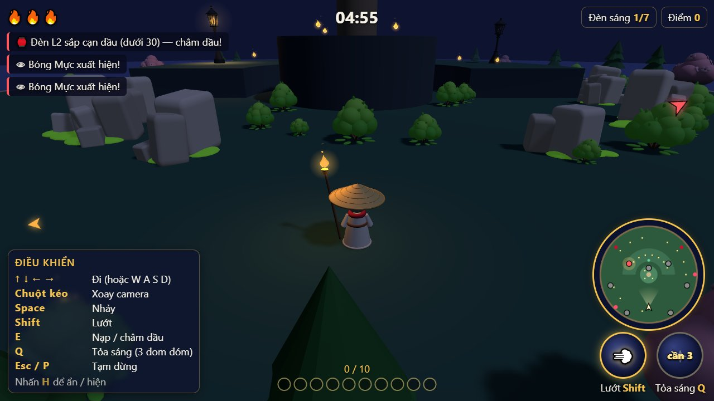

# Đảo Đèn Lồng

> Day 12 AI SDLC · Nguyễn Thị Duyên · 2A202603698 · Tài liệu lab: [docs/lab/](docs/lab/README.md)
> **Bản phát hành:** [v1.0.0](https://github.com/duyen26912/K5-L3A-DAY12-NguyenThiDuyen-2A202603698-AI-SDLC-Dao-Den-Long/releases/tag/v1.0.0) · **Video demo:** đính kèm Release v1.0.0 (`demo.mp4`)

Game 3D góc nhìn thứ ba qua **3 Đêm**: Đảo Bến, Đảo Cau, Đảo Chuông. Bạn là **Mây**, người giữ đèn nhỏ tuổi, nhặt đom đóm, mang về thắp lại các **Đèn Lồng Lớn**, né **Bóng Mực** và **Gió Lạc** trong sương đen. Đèn hết dầu sẽ tắt — phải châm dầu và **giữ đủ đèn sáng tới bình minh** (≥ 60% số đèn) mới thắng Đêm; hết Ngọn Lửa là thua. Thắng cả 3 Đêm để thấy Bình Minh, rồi ghi tên lên **bảng xếp hạng**.



**Stack:** TypeScript · [Three.js](https://threejs.org) r187 (WebGL2, chạy trên trình duyệt) · Node.js cho build, server, headless, soak · Playwright cho benchmark.

## Yêu cầu hệ thống

| | Tối thiểu |
|---|---|
| Hệ điều hành | macOS, Linux hoặc Windows |
| Node.js | **≥ 20.19** (kèm npm) |
| Trình duyệt | Chrome / Edge / Firefox / Safari bản mới, có WebGL2 |
| Đồ họa | GPU tích hợp là đủ (đo trên AMD Radeon tích hợp: ~186 FPS ở cảnh benchmark 1280×720) |
| Benchmark | Chrome hoặc Edge đã cài; không có thì lần đầu tự tải Chromium của Playwright (~150 MB) |
| Headless / soak | Chỉ cần Node, không cần GPU hay màn hình |

## Cài đặt và chạy (3 lệnh)

```bash
git clone https://github.com/duyen26912/K5-L3A-DAY12-NguyenThiDuyen-2A202603698-AI-SDLC-Dao-Den-Long.git && cd K5-L3A-DAY12-NguyenThiDuyen-2A202603698-AI-SDLC-Dao-Den-Long
```

```bash
npm ci && npm run build
```

```bash
npm start
```

`npm start` (= `node scripts/run.mjs`, đúng `run_cmd` của contract) mở server tại `http://localhost:4173` và tự mở trình duyệt; bảng xếp hạng được lưu ở `~/.dao-den-long/leaderboard.json`. Tùy chọn: `--port 5000`, `--no-open`. Chọn seed cố định: `http://localhost:4173/?seed=2026`.

**Không muốn build?** Tải `dao-den-long-v1.0.0-web.zip` ở [Release v1.0.0](https://github.com/duyen26912/K5-L3A-DAY12-NguyenThiDuyen-2A202603698-AI-SDLC-Dao-Den-Long/releases/tag/v1.0.0), giải nén rồi chạy `node scripts/run.mjs` (chỉ cần Node, không cần `npm ci`). Thư mục `dist/` trong đó là bản web tĩnh: đặt lên host tĩnh bất kỳ cũng chơi được (khi đó bảng xếp hạng lưu trong trình duyệt).

## Điều khiển

| Phím mặc định | Hành động |
|---|---|
| ↑ ↓ ← → (hoặc W A S D) | Đi tới / lùi / sang trái / sang phải (theo hướng camera) |
| Giữ chuột trái và kéo | Xoay camera (độ nhạy chỉnh trong Cài đặt) |
| Space | Nhảy |
| Shift | Lướt |
| E | Nạp ánh sáng vào đèn tắt / châm dầu đèn đang sáng (trong 2 m) |
| Q | Tỏa Sáng: tốn 3 đom đóm, làm choáng và đẩy lùi Bóng Mực trong 5 m |
| Esc / P | Tạm dừng (Tiếp tục · Chơi lại Đêm · Cài đặt · Về menu) |
| H | Ẩn / hiện bảng điều khiển trên màn hình |
| F3 | Bật/tắt bộ đếm FPS (hoặc mở với `?fps=1`) |

Mọi phím hành động **đổi được** trong *Cài đặt → Đổi phím* (mỗi hành động 2 phím; trùng phím thì báo và không gán; có nút *Khôi phục mặc định*; được lưu). Bảng điều khiển trên màn hình tự cập nhật theo phím mới.

Luồng chơi: Menu → giới thiệu Đêm (lời Ông Đăng) → chơi → kết quả → Đêm kế tiếp. Thua thì chơi lại Đêm đó. Sau **Bình Minh** (thắng Đêm 3) hoặc sau khi **thua**, nhập tên để lưu điểm.

## Dễ tiếp cận (Cài đặt)

| Tùy chọn | Tác dụng |
|---|---|
| Đổi phím | Xem phần Điều khiển |
| Phụ đề / chỉ báo hình ảnh (bật sẵn) | Dòng chữ khi: Bóng Mực xuất hiện (kèm **mũi tên đỏ** chỉ hướng ở mép màn hình), gió sắp thổi, 10 giây cuối, đèn có dầu < 30 |
| Giảm chuyển động | Tắt chớp đỏ khi trúng đòn, lóe sáng khi nhặt, chữ/thanh nhấp nháy (game không có rung camera) |
| Chữ lớn (×1.25) | Phóng to mọi chữ giao diện; cỡ chữ mặc định đã ≥ 18 px ở 1280×720 |
| Bảng màu dễ phân biệt | Bóng Mực `#00B3FF`, cảnh báo `#FFFFFF` kèm ⚠ (Ticket-03) |
| Âm lượng, độ nhạy chuột | Lưu giữa các lần mở game |

## Bảng xếp hạng

- Top 10, sắp theo điểm giảm dần; bằng điểm thì ai đạt trước đứng trên. Mỗi mục: `name`, `score` (tổng điểm các Đêm đã thắng trong lượt), `nights_won` (0–3), `achieved_at` (ISO 8601 có múi giờ), `seed`.
- Tên 3–12 ký tự: chữ (gõ được **tiếng Việt có dấu**), số, `_`.
- Menu → *Bảng xếp hạng* để xem. Xuất ra file:

```bash
node scripts/run.mjs --export-leaderboard out.json
```

→ `{"entries": [ ... ]}` đúng thứ tự. Đổi chỗ lưu bằng biến môi trường `DDL_DATA_DIR`.

## Luật chơi và cách tính điểm (Ticket-02 + Ticket-03)

- Chạy 6 m/s, nhảy 7 m/s, Lướt 14 m/s trong 0.2 s (hồi chiêu 1.5 s). Rơi khỏi đảo: −1 Ngọn Lửa, mất hết đom đóm, hồi sinh ở điểm xuất phát.
- Đom đóm tự nhặt trong 1 m. **Sức chứa = 10 + 2 × số lần thắp thành công**, tối đa 20.
- Đèn cần 10 đom đóm để thắp lần đầu (5 nếu thắp lại). Đèn sáng có **dầu 100, hao 1/giây**; bấm E ở đèn đang sáng để châm dầu (mỗi đom đóm +10). Hết dầu thì đèn **tắt**.
- Đèn có dầu ≥ 30 tạo vùng an toàn 6 m. Dầu < 30: mất vùng an toàn, đèn nhấp nháy, Bóng Mực kéo tới **hút dầu** (5/giây).
- Bóng Mực phát hiện trong 12 m, bỏ đuổi ngoài 18 m; chạm vào thì −1 Ngọn Lửa (có 3), rơi một nửa số đom đóm, bất tử 1.5 s.
- Gió Lạc (Đêm 2–3) cướp tối đa 3 đom đóm khi bạn mang ≥ 5; Bùa Gió: 10 s chạy 7.2 m/s và Lướt không hồi chiêu.
- Đêm 1 / 2 / 3 dài **240 / 270 / 300 s**. **Thắng** khi còn sống tới bình minh và có ≥ 3/5, 4/6, 5/7 đèn đang sáng.
- **Điểm:** +5 mỗi đom đóm nạp/châm, +100 thắp lần đầu, +40 thắp lại, Tỏa Sáng +5 mỗi Bóng Mực (+15 nếu nó đang hút dầu); bình minh (khi thắng): +50 + dầu còn lại mỗi đèn sáng, +50 mỗi Ngọn Lửa.

Số có khóa tuning nằm trong [game.contract.json](game.contract.json) (game đọc thẳng file này); bản đồ chuẩn ở `src/core/maps.ts`. Spec: [Phase 2](docs/notes/spec-phase-2.md), [Ticket-03](docs/lab/TICKET-03.md), [Ticket-04](docs/lab/TICKET-04.md); quyết định thiết kế: [ADR-001](docs/notes/adr-001-den-can-dau.md). Giả định: [docs/notes/assumptions.md](docs/notes/assumptions.md).

## Test Contract v1.3 — các lệnh

| Khóa trong `game.contract.json` | Lệnh |
|---|---|
| `run_cmd` | `node scripts/run.mjs` |
| `headless_cmd` | `node dist-headless/headless.mjs` |
| `bench_cmd` | `node scripts/bench.mjs` |
| `soak_cmd` | `node --expose-gc --max-semi-space-size=1 --no-opt dist-headless/soak.mjs` |

Tất cả cần `npm ci && npm run build` trước.

### Headless

```bash
node dist-headless/headless.mjs --seed 1 --night 2 --scenario tests/scenarios/p2-n2-pad.scenario.json --inputs tests/scenarios/p2-step-onto-pad.inputs.json --ticks 150 --out out.jsonl
```

- `--night` nhận 1, 2, 3; thêm `--snapshot-every n`. Logic 60 tick/giây, không cửa sổ, không GPU; một Đêm đầy đủ chạy khoảng 0.1 s.
- Output JSONL: `snapshot`, `event`, `end`. Cùng seed + scenario + inputs → output giống hệt (đã so sha256 giữa Windows và Linux).
- Mã thoát: 0 khi chạy xong; 2 khi file scenario/inputs sai định dạng; 1 khi tham số dòng lệnh sai.

### Benchmark

```bash
node scripts/bench.mjs --seed 42 --duration 30 --out bench.json
```

- Mở Chromium (ưu tiên Chrome/Edge đã cài) **cửa sổ 1280×720, không toàn màn hình**, vẽ đúng 1280×720 điểm ảnh, chạy `dist/index.html?bench=1`: Đêm 1 với đầy đủ ánh sáng, 200 Bóng Mực `wander` rải đều trên đảo, 100 đom đóm, L1–L3 sáng dầu 100; tắt sinh thêm, sát thương, nhặt, hao dầu, kết thúc Đêm; không input; camera bay vòng bán kính 30 m, cao 15 m, 15 s/vòng ngược chiều kim đồng hồ. 3 s khởi động rồi đo đúng `--duration` giây, ghi `bench.json`, thoát mã 0.
- **Vsync:** tắt bằng cờ Chromium `--disable-gpu-vsync --disable-frame-rate-limit` → `vsync_off: true`.
- **`peak_mem_mb: null`:** game là bản web, trang không đọc được RSS của tiến trình trình duyệt; file ghi thêm `js_heap_peak_mb` (JS heap đỉnh của trang) để tham khảo.
- `load_ms`: từ lúc tiến trình `bench.mjs` bắt đầu (gồm khởi động server + Chromium) tới khung hình đầu tiên của cảnh bench.
- Linux không có màn hình (không `DISPLAY`/`WAYLAND_DISPLAY`) thì chạy Chromium headless, ghi rõ trong `renderer`.
- Kết quả tự đo (máy Ryzen 5 5600H, GPU tích hợp, Windows 10) — [bench.json](bench.json): **avg 186.3 FPS, p1_low 84.7 FPS, p95 9.2 ms, load 1181 ms**.

### Soak test

```bash
node --expose-gc --max-semi-space-size=1 --no-opt dist-headless/soak.mjs --seed 7 --nights 10 --out soak.json
```

10 Đêm liên tiếp trong một tiến trình (Đêm 1 → 2 → 3 xoay vòng, Đêm thứ i dùng seed 7 + i), input ngẫu nhiên theo seed (mỗi 30 tick đổi hướng; mỗi tick 5% nhảy, 3% lướt, 2% tỏa sáng, 10% tương tác). Kết quả — [soak.json](soak.json): **crashes 0**, RSS tăng trong ngưỡng ×1.2 (số cụ thể trong file).

Vì sao có cờ `--max-semi-space-size=1 --no-opt`: game **không rò rỉ** (JS heap đang dùng đứng yên ~3,5 MB qua 400 Đêm), nhưng với cờ mặc định, trên Linux RSS vẫn tăng 40 → 75 MB do V8 nới vùng nhớ thế hệ trẻ và giữ bộ nhớ của trình biên dịch tối ưu. Hai cờ giữ RSS phẳng (40,8 → 43,8 MB sau 400 Đêm). Bảng đo đầy đủ: [docs/proof/phase-4/README.md](docs/proof/phase-4/README.md).

## Test và kiểm chứng

```bash
npm test
```

```bash
npm run build && npm run verify -- phase-4
```

- `npm test`: 83 test (luật Đêm 1, Phase 2, dầu đèn Phase 3, CLI headless thật, cảnh bench, soak, bảng xếp hạng, đổi phím), chạy khoảng 1 giây.
- `npm run verify -- phase-4`: 27 scenario headless chạy bằng đúng `headless_cmd`, mỗi cái 2 lần để kiểm tra tất định; so byte-by-byte với bằng chứng phase-3 (luật không đổi); chạy `soak_cmd` và lệnh xuất bảng xếp hạng. Ghi bằng chứng vào `docs/proof/<phase>/`.
- CI: [.github/workflows/ci.yml](.github/workflows/ci.yml) chạy typecheck, build, test, verify trên Ubuntu và macOS mỗi lần push.
- Bằng chứng: [Phase 1](docs/proof/phase-1/README.md) · [Phase 2](docs/proof/phase-2/README.md) · [Phase 3](docs/proof/phase-3/README.md) · [Phase 4](docs/proof/phase-4/README.md). Retro: [docs/notes/retro.md](docs/notes/retro.md).

## Cấu trúc

```text
game.contract.json     Test Contract v1.3: lệnh + tuning (nguồn duy nhất của các con số)
src/core/              luật chơi thuần (không đồ họa), cảnh bench, bảng xếp hạng, đổi phím — dùng chung cho game, headless, test
src/render/            Three.js + HUD + âm thanh, chỉ đọc trạng thái core
src/headless.ts        CLI headless          src/soak.ts   soak test
src/leaderboard-store.ts  lưu bảng xếp hạng ra đĩa (Node)
scripts/               run.mjs (run_cmd), bench.mjs (bench_cmd), static-server.mjs, verify.mjs, hooks/
tests/                 test + scenarios/
AGENTS.md, CLAUDE.md   hướng dẫn cho agent AI; .claude/ skill verify-phase, hook Stop
docs/notes/            giả định, ADR, nhật ký dùng AI, retro
docs/proof/            bằng chứng từng phase
docs/lab/              tài liệu gốc của lab
```

## Sáng tạo của tôi

Tất cả chỉ nằm ở phần hiển thị (`src/render/`), không đổi luật hay output headless (headless không import `src/render`; `verify -- phase-4` so byte-by-byte với phase-3). Trong cảnh benchmark, trang trí sáng tạo tắt.

1. **Đèn Lồng Lớn dạng cột đèn** với 3 mức sáng và ngọn lửa trong kính; đèn yếu nhấp nháy, đèn tắt xẹp và rách.
2. **Cảnh vật tự dựng:** bụi cây 3 cỡ, cây thông, hoa anh đào, **cây cau** (Đảo Cau), **cầu gỗ Đêm 2** có bệ đá và trụ đèn — đặt tránh đường đi, đèn, điểm sinh và bục nhảy.
3. **Lời Ông Đăng** ở màn giới thiệu từng Đêm; màn Bình Minh khi thắng cả 3 Đêm.
4. **Nhân vật có hoạt cảnh** (giữ bảng màu chuẩn): Mây đội **nón lá**, áo ngà `#E8E2D0`, khăn đỏ `#C8102E` bay theo bước chạy, cầm gậy lửa; đom đóm là **ngọn lửa nhỏ** lóe sáng khi nhặt; Bóng Mực có mắt sáng và 8 xúc tu; Gió Lạc là dải lụa uốn sóng; Bùa Gió, bục nhảy trống gỗ mặt lá sen.
5. **Menu chính** kiểu game: bảng cách chơi + nút bắt đầu bên trái, tên game với đèn lồng đỏ đung đưa ở giữa, Mây 3D cầm đuốc bên phải.
6. **HUD kiểu game hành động:** nút kỹ năng tròn có hồi chiêu quét và đếm giây, **bản đồ nhỏ** (đảo, đèn sáng/yếu/tắt, đom đóm, Bóng Mực, hướng nhìn), cụm đá phủ rêu trên đảo.
7. **Màn Bình Minh:** trời chuyển cam hồng, mặt trời nhô lên trên biển mây, đèn trời bay lên, sương đen và Bóng Mực tan biến; bảng điểm từng Đêm.

## Giấy phép

[MIT](LICENSE). Nguồn tài nguyên và công cụ: [CREDITS.md](CREDITS.md).
